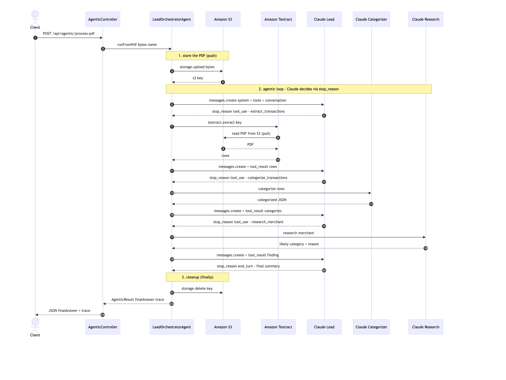
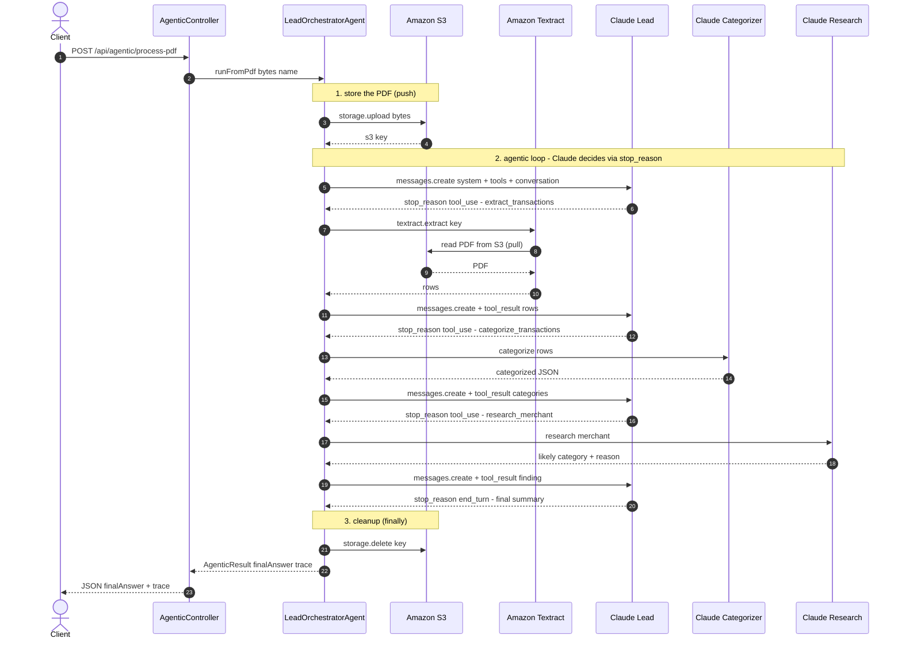
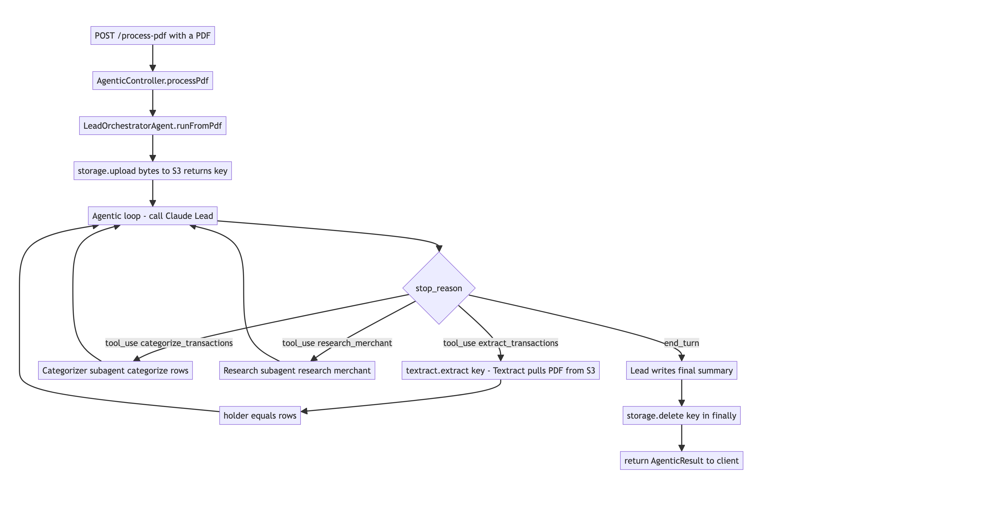
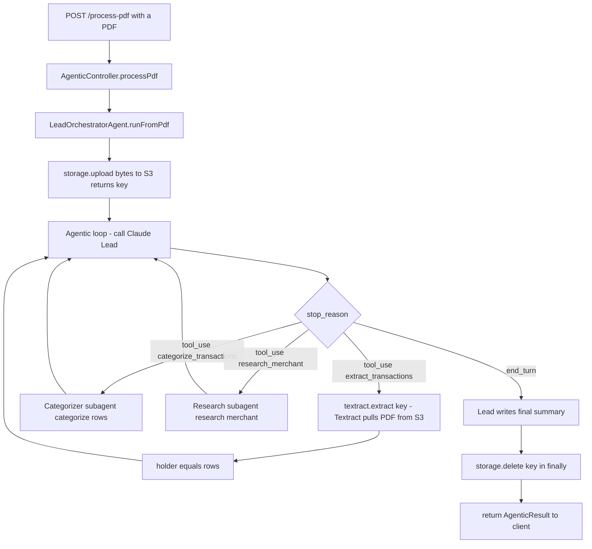

# Agentic pipeline flow — `/api/agentic/process-pdf`

The multi-agent document-intelligence flow: the lead orchestrator uploads the PDF to S3,
then drives a `stop_reason` loop that delegates to **Amazon Textract** (deterministic tool)
and two **Claude subagents** (categorize, research), and finally summarizes.



> To render in mermaid.live / mermaid.ai, paste **only** the lines of ONE diagram below —
> start at `sequenceDiagram` or `flowchart TD`, and do **not** include the ```` ```mermaid ````
> fence lines or anything else from this file.

## 1. Sequence diagram — the full flow



## 2. Flowchart — the `stop_reason` decision loop





## Boundaries (which calls leave the JVM)

| Call | Leaves the JVM to | Direction |
|---|---|---|
| `storage.upload(bytes)` | AWS → S3 | you **push** the PDF in |
| `textract.extract(key)` | AWS → Textract | Textract **pulls** the PDF from S3 itself |
| `client.messages().create(...)` | Anthropic → Claude (lead) | the orchestrator's decisions |
| `categorizer.categorize(rows)` | Anthropic → Claude (subagent) | the call that categorizes |
| `research.research(...)` | Anthropic → Claude (subagent) | resolve cryptic merchants |
| `storage.delete(key)` | AWS → S3 | remove the PDF |

## The two kinds of tool
- **Deterministic tool** — `extract_transactions` wraps Amazon Textract (no LLM).
- **Subagent tools** — `categorize_transactions` and `research_merchant` each wrap their own Claude call.

The lead orchestrator does no work itself; it sequences all three through the `stop_reason` loop.
